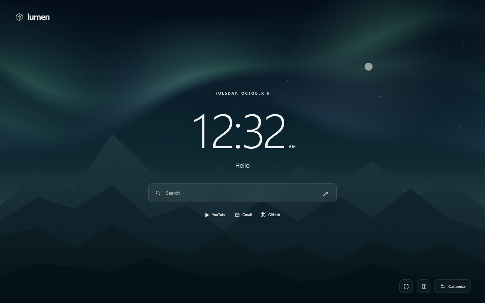
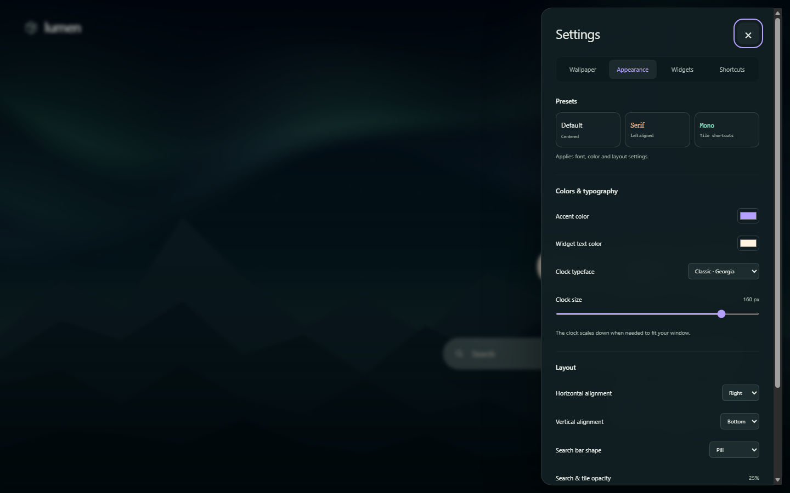
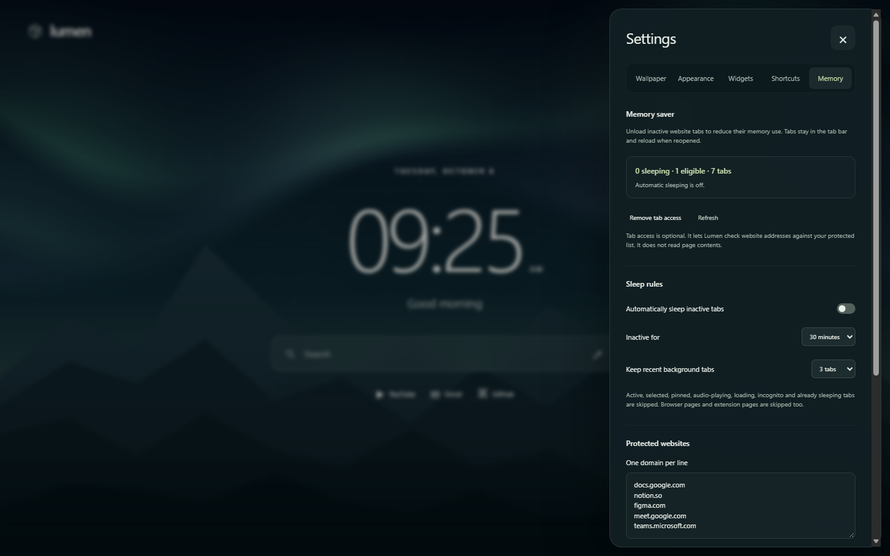

# Lumen

A simple, customizable new-tab extension for Chrome and Edge. Set a local video as your wallpaper, or use one of the built-in animated backgrounds. 



## Installation

You don't need a build step to use this. 

1. Download or clone this repo.
2. Go to `chrome://extensions` (or `edge://extensions`) and turn on **Developer mode** in the top right.
3. Click **Load unpacked** and select the `extension` folder.
4. Open a new tab and hit **Customize** to set things up.

*Note: Don't delete or move the folder after loading it, or the browser will lose track of the extension.*

## Features

- **Media support:** Works with MP4 and WebM videos, plus JPG, PNG, and WebP images. Max file size is 150MB, but shorter/smaller videos will load much faster. 
- **Tweaks:** Adjust brightness, blur, saturation, playback speed, and crop position right from the dashboard.
- **Widgets:** Customizable clock (fonts, colors, alignment, time zones) and up to 12 editable shortcuts. 
- **Declutter:** Toggle visibility for the clock, date, search bar, greeting, and shortcuts independently.
- **Performance:** Videos loop silently and automatically pause when you switch to another tab to save resources. 



**Looking for wallpapers?** 
You can grab some free live wallpapers [here](https://github.com/notgamermx/wallpaper#live-wallpapers). Just download one, go to **Customize → Wallpaper** in Lumen, and drop it in.

**Privacy:** 
Everything stays strictly local to your browser profile. Lumen has zero analytics, no user accounts, and makes no remote requests for wallpapers. Check the [privacy docs](docs/privacy.md) if you want the specifics.

## Memory Saver

Lumen includes an optional memory saver to unload tabs you aren't actively using. 

To turn it on, go to **Customize → Memory → Enable tab access**. The browser will ask for permission so Lumen can read your open tabs. From there, you can enable **Automatically sleep inactive tabs**, or just click **Sleep eligible tabs** when you want to run it manually. 

**How it works:**
- Set a timer between 5 and 120 minutes of inactivity.
- You can protect up to 10 recent background tabs from being put to sleep, or whitelist specific website domains completely.
- Lumen automatically skips tabs that are active, pinned, playing audio, loading, or private. 
- It runs about once a minute and unloads a maximum of 10 tabs per run to keep things smooth. 

When you click back into a sleeping tab, it just reloads. *Just a heads up:* Lumen can't see the actual content of your pages, so it won't always know if you have unsaved form data. Save your work!



## Updating

To update, just replace the files in your existing `extension` folder, go back to your browser's Extensions page, and click the **Reload** icon on the Lumen card. 

If you are migrating from an older installation (like the old `Wallpaper/lumen` folder), don't just load this new folder separately—Chrome will treat it as a brand new extension and you'll lose your settings. Instead, copy the contents of the new `extension` folder into your old folder and hit reload.

## Development

The extension itself is written in vanilla JavaScript with zero runtime dependencies. If you want to run the dev commands, you'll need Node.js 22+.

```sh
npm ci
npm test
npm run check
npm run package
```

Packaging outputs a ZIP to the `dist/` folder. `npm run format` cleans up the code.

**Testing:**
Run page tests with `npm run test:browser` and memory-saver tests with `npm run test:memory-browser`. These run in isolated, headless Edge profiles on Windows (you can set `BROWSER_PATH` to another Chromium browser if you prefer). The memory test uses a temporary copy of the extension and speeds up the clock to test tab unloading without actually waiting 5 minutes. Test outputs (screenshots, etc.) go to the `test-results` folder.

```text
extension/          # The actual extension folder to load
  assets/           # Icons
  scripts/          # Core logic, UI, and storage
  styles/           # CSS
tests/              # Test suites
scripts/            # Build and validation scripts
docs/               # Extra documentation
.github/workflows/  # CI pipelines
```

## Limitations

- Requires Chrome or Edge v121 or higher.
- Chrome natively blocks new-tab overrides in Incognito mode.
- If you have another new-tab extension installed, they might fight for priority. 
- Video playback relies on your browser's built-in codecs. 
- Firefox is entirely untested.
